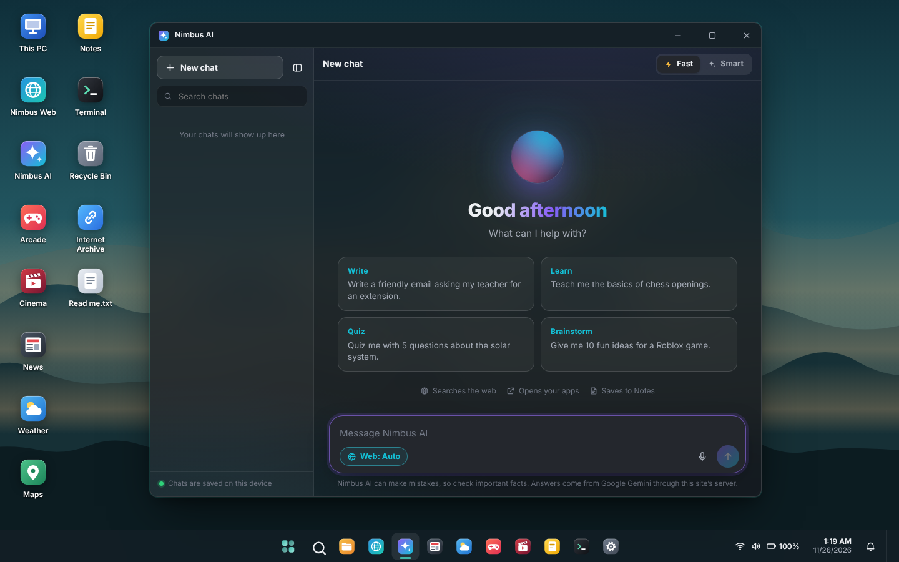

# Nimbus OS

**A free computer in your browser.** No download, no account. Made by Christian.

### ▶ [Open Nimbus OS](https://daugheritychristian-ops.github.io/nimbus-os/)

## What's inside

- **Nimbus AI**: an assistant that searches the web, cites its sources, writes and explains, and opens apps for you.
- **Nimbus Web**: a working browser with tabs, bookmarks, history, web, image and video search, and reader view.
- **YouTube, Twitch, Spotify and TikTok**: watch and listen without leaving Nimbus.
- **Arcade**: Snake, 2048, Minesweeper, Blocks, Breakout and Tic-Tac-Toe.
- **Cinema**: classic public-domain films and trailers.
- **News, Weather and Maps** with live data.
- **Files, Notes, Paint, Calculator, Terminal, Task Manager, Clock** and more.
- Windows you can drag, resize, snap to halves or corners, and switch between with Alt+`.
- Wallpapers, accent colours, light and dark themes, and desktop widgets.
- Install it as an app from Chrome or Edge, and it opens offline too.

## Handy links

Open an app straight away by adding it to the link, for example
[`#ai`](https://daugheritychristian-ops.github.io/nimbus-os/#ai),
[`#youtube`](https://daugheritychristian-ops.github.io/nimbus-os/#youtube) or
[`#arcade`](https://daugheritychristian-ops.github.io/nimbus-os/#arcade).

## Privacy

Your files, notes, chats and settings are saved in your own browser on your own device. Web searches and AI questions go through Nimbus's server only to fetch the answer.
